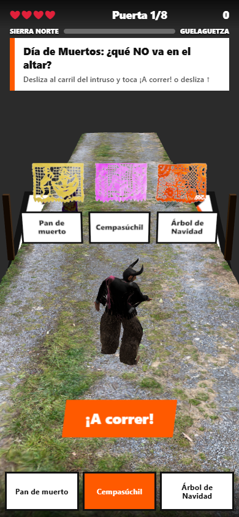
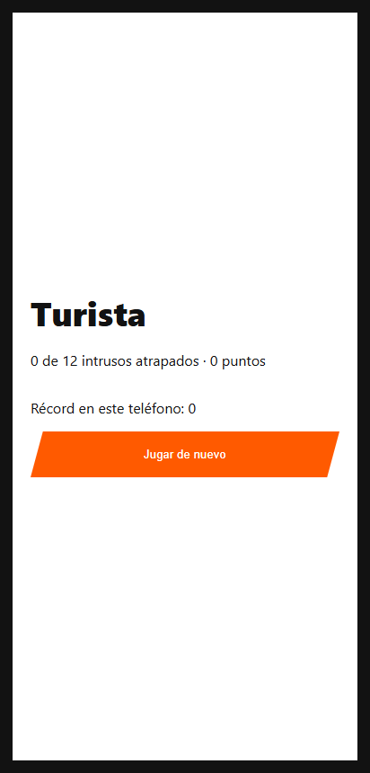

# Atrapa al Intruso · Diablo RA

Minijuego de **realidad aumentada** para el teléfono que se activa con un **marcador QR de diseño propio**. Al apuntar la cámara al marcador, un camino sale del papel y se queda frente a ti; por él corre un **Diablo de Juxtlahuaca**, personaje de las danzas de Santiago Juxtlahuaca, en la Mixteca oaxaqueña. En cada puerta hay tres letreros sobre cultura oaxaqueña: dos son ciertos y uno es **el intruso**. Hay que cambiar de carril para que el Diablo cruce por el intruso.

> Actividad 1 · Realidad Virtual y Aumentada · 2026

**La historia:** el Diablo se quedó dormido en la **Sierra Norte de Juárez** y sus compañeros se fueron en los camiones a la **Guelaguetza**. Hay que bajar corriendo por el camino de tierra hasta el Valle de Oaxaca. Una barra "Sierra Norte → Guelaguetza" avanza con cada puerta, la última lleva el letrero de la Guelaguetza y, si llegas con vidas, el final dice que llegaste a tiempo.

**Pruébalo:** https://diablo-ra-qr.carlos-gomez-dev13.workers.dev/ · **Modo demo en PC:** https://diablo-ra-qr.carlos-gomez-dev13.workers.dev/?demo



### El marcador solo arranca el juego

El marcador puede estar en una mesa o en la pared. En cuanto MindAR lo reconoce, el camino sale del papel y se acomoda frente a la cámara en una vista fija de tercera persona que llena la pantalla (`VISTA` en `js/main.js`). Desde ahí se deja de rastrear: se juega aunque el marcador salga de cuadro y el teléfono ahorra batería. Los avisos van en una franja compacta arriba para no tapar el camino.

## Cómo se juega

| | |
|---|---|
| **Objetivo** | Atrapar al intruso en las 8 puertas, corriendo a toda velocidad como en un *endless runner*. Frente a cada puerta el Diablo se detiene en alerta y la pregunta queda sola en pantalla: eliges carril con calma y sigues con **¡A correr!** o deslizando ↑. El camino hasta la puerta va despejado. |
| **Inicio** | El Diablo espera de frente, en primer plano, con su animación de alerta. Al tocar **¡A correr!** se voltea, arranca y la vista pasa detrás de él (tercera persona). |
| **Controles** | Sin botones, como en los *runners* del teléfono: desliza el dedo ← → para cambiar de carril y ↑ para saltar. Responde en cuanto el dedo se mueve, sin esperar a soltarlo. En PC: flechas y espacio. |
| **Obstáculos** | Agaves en un carril (esquívalos o sáltalos: −30 si chocas) y cercas de carrizo que tapan los 3 carriles (solo se saltan: chocar cuesta un ❤). |
| **Premios** | Bolsa de **Takis** +25. **Botella de mezcal**: +50 y 4 s de turbo, más rápido y atravesando los obstáculos. |
| **Puntaje** | Acierto: +100 con combo x2 y x3, y el Diablo acelera. Cada puerta sube un poco la velocidad. |
| **Dificultad** | **Media**: preguntas de cultura general de Oaxaca, más lenta (0.26 marcadores por segundo), 1 obstáculo por tramo y 4 vidas. **Difícil** y **Muy difícil**: preguntas para oaxaqueños, velocidad 0.42 y 0.54, 3 y 4 obstáculos por tramo, más cercas y 3 y 2 vidas. Hay récord por dificultad. |
| **Tutorial** | La primera vez se juega un tutorial de 8 pasos que pausa la acción y explica cada cosa: Takis, agave, salto, cerca y cómo cruzar por el intruso. Se puede repetir con el botón **Tutorial**. |
| **Vidas** | Cada intruso que se escapa o cada cerca que no saltas cuesta un ❤. |
| **Fin** | Al cruzar las 8 puertas o al perder las 3 vidas. El Diablo voltea hacia ti y baila, y se muestra un rango: *Turista*, *Fuereño curioso*, *Paisano* u *Oaxaqueño de corazón*, y el récord del teléfono. |
| **Retroalimentación** | Cada cambio de carril suena y vibra. Un acierto lanza confeti, un acorde y una vibración corta. Un error hace un destello rojo, un zumbido y una vibración doble. Con turbo, la pantalla se enciende con un borde de fuego. |

Hay **18 preguntas de cultura general** para la dificultad media y **41 preguntas para oaxaqueños** para difícil y muy difícil: regiones, los 7 moles, magueyes silvestres, días de plaza, pueblos artesanos, Monte Albán, Guelaguetza, calendas, el carnaval putleco y más. En cada partida salen 12 al azar y, después de cada puerta, aparece un dato curioso.

## Herramientas

- [MindAR](https://github.com/hiukim/mind-ar-js) 1.2.5: rastreo de imagen en el navegador.
- [three.js](https://threejs.org/) 0.160: render 3D y carga de GLB.
- Web Audio API: efectos sintetizados en código. La música de fondo (*Son Calenda*) se toca desde `assets/audio/musica.mp3`.
- Vibration API: retroalimentación háptica en Android.
- Python + Pillow + qrcode + OpenCV: generación y análisis del marcador.
- Meshy AI: modelo del Diablo con rig y animaciones.
- Blender 5.2: reducción del Diablo, del agave escaneado y de la botella de mezcal.

No hay paso de compilación: es HTML + JavaScript (módulos ES) y las librerías se cargan desde jsDelivr.

## Estructura

```
index.html            pantallas, HUD e import map
css/styles.css        estilos (alto contraste, botones grandes)
js/main.js            escena RA, bucle de juego, controles y retroalimentación
js/preguntas.js       banco de preguntas "atrapa al intruso"
js/modelos.js         carga de GLB con respaldo procedural
js/audio.js           música y efectos con Web Audio
assets/targets.mind   marcador compilado para MindAR
assets/models/        diablo.glb, maguey.glb (agave), mezcal.glb, takis.glb, camino.glb (grava)
modelos/              script de Blender que prepara los modelos
marcador/             generador del marcador y compilador de MindAR
```

## Instalación y uso

1. Clona el repositorio:
   ```bash
   git clone https://github.com/CharlieMorales13/diablo-ra-qr.git && cd diablo-ra-qr
   ```
2. Sirve la carpeta con cualquier servidor estático:
   ```bash
   npx serve .
   ```
   La cámara solo funciona con **HTTPS** o en `localhost`. Para probar en el teléfono, publícalo (paso 3) o usa un túnel HTTPS.
3. Publicación: sube la carpeta tal cual a **Vercel** (`vercel deploy`) o a **Cloudflare Pages** (directorio de salida `/`, sin comando de build).
4. Imprime `marcador/marcador.png` (mínimo 10 cm de lado) o ábrelo en otra pantalla.

### Flujo con el marcador

1. **Escanea el QR del marcador** con la cámara normal del teléfono: el QR contiene la URL del juego y abre la página.
2. Toca **Jugar**. Se abre la cámara de RA (el navegador pide permiso una vez).
3. **Apunta al mismo marcador.** En cuanto MindAR lo reconoce, el camino sale del papel y el Diablo espera a que toques **¡A correr!**.
4. Desde ahí ya no hace falta el marcador: puedes bajar el teléfono a una posición cómoda y jugar.

El marcador cumple dos funciones: el QR lleva a la experiencia y el diseño completo (grecas, letras, esquirlas) es la imagen que reconoce MindAR para arrancar el juego.

**Modo demo sin cámara:** `index.html?demo` dibuja el marcador en pantalla para probar en la computadora.

### Regenerar el marcador con la URL final

El QR del marcador apunta a la URL del juego. Después de publicar:

```bash
pip install qrcode pillow opencv-python numpy
python marcador/generar_marcador.py https://diablo-ra-qr.carlos-gomez-dev13.workers.dev/ marcador/marcador.png
```

El script imprime los puntos de rastreo, la simetría y si el QR se lee, y guarda un mapa de puntos en `marcador_puntos.png`. Después abre `marcador/compilar.html` desde el servidor, toca **Usar marcador.png** y reemplaza `assets/targets.mind` con el archivo descargado.

**Diseño del marcador:** un QR solo es repetitivo y confunde al rastreador. Por eso lleva un marco con una muesca naranja que rompe la simetría, grecas de Mitla (xicalcoliuhqui) distintas a cada lado, tipografía grande y esquirlas en una sola esquina. Resultado del análisis con la URL publicada: 8,999 puntos ORB, simetría 0.48, 98 % de cobertura y 39 % de los puntos fuera del QR.

### Modelos 3D

| Modelo | Origen | Adaptación en Blender (`modelos/preparar_modelos.py`) | Peso |
|---|---|---|---|
| `diablo.glb` | Diablo de Juxtlahuaca generado con **Meshy AI** a partir de mi prompt, con rig automático y animaciones | Malla de 211 k a 20 k triángulos (se reduce en reposo y conserva los pesos del rig), texturas de 2048 a 1024 px y solo las animaciones `Alert` (de frente al inicio), `Running` (al correr) y `All_Night_Dance` (pantalla final). De 18 MB a 1.7 MB. | 1.7 MB |
| `maguey.glb` | [Agave Americana](https://sketchfab.com/3d-models/agave-americana-efe126efa459471c81cfc3132357b1b6), escaneo de Discobolo | De 1 M triángulos y 48 MB a 16 k. Se le quita el cuadro de tierra del escaneo por color de textura (café contra verde) y altura. | 582 KB |
| `mezcal.glb` | [Malaespina Mezcal bottle](https://sketchfab.com/3d-models/malaespina-mezcal-bottle-8c5ae788601b4e83931da9e4e28d8baf) de santibanezjuan | Malla a 4 k triángulos y texturas de 512 px | 305 KB |
| `camino.glb` | [gravel road](https://sketchfab.com/3d-models/gravel-road-5c29774fd35f4c85a531d6abd7ceef34) de SPLEEN VISION | Escaneo de 158 k caras reducido a 12 k con la textura de 1024 px y filtrado anisotrópico para que se vea nítido en ángulo. En el juego se usan 3 tramos que se reciclan al pasar, aplanados para que el Diablo no se hunda en los baches. | 2.4 MB |
| `takis.glb` | [Takis Fuego - México](https://sketchfab.com/3d-models/takis-fuego-mexico-7426e5fa188344668ec3b9dbab348bae) de Luiss Maker | Malla a 5 k triángulos y texturas de 512 px | 176 KB |

Para regenerarlos, con el GLB de Meshy y los GLB de Sketchfab descargados en una carpeta:

```bash
blender --background --python modelos/preparar_modelos.py -- <diablo_meshy.glb> <carpeta_sketchfab>
```

En el juego cada modelo se escala solo (Diablo 24 cm, agave 11 cm, mezcal 8 cm, Takis 12 cm en la escala del marcador), la animación de correr se acelera con la velocidad del Diablo y, si faltara un GLB, se usa un respaldo procedural.

## Capturas

| Partida | Pantalla final |
|---|---|
|  |  |

## Créditos y licencias

| Recurso | Autor / fuente | Licencia |
|---|---|---|
| Código del juego | Carlos Antonio Gómez Morales | MIT (ver `LICENSE`) |
| Marcador "Atrapa al intruso" | Carlos Antonio Gómez Morales | MIT |
| Diablo de Juxtlahuaca (prompt propio, rig y animaciones) | Generado con [Meshy AI](https://www.meshy.ai), plan gratuito | CC BY 4.0 |
| Agave (*Agave Americana*) | [Discobolo · Sketchfab](https://sketchfab.com/3d-models/agave-americana-efe126efa459471c81cfc3132357b1b6) | CC BY 4.0 |
| Botella de mezcal (*Malaespina Mezcal bottle*) | [santibanezjuan · Sketchfab](https://sketchfab.com/3d-models/malaespina-mezcal-bottle-8c5ae788601b4e83931da9e4e28d8baf) | CC BY 4.0 |
| Camino de grava (*gravel road*) | [SPLEEN VISION · Sketchfab](https://sketchfab.com/3d-models/gravel-road-5c29774fd35f4c85a531d6abd7ceef34) | CC BY 4.0 |
| Bolsa de Takis (*Takis Fuego - México*) | [Luiss Maker · Sketchfab](https://sketchfab.com/3d-models/takis-fuego-mexico-7426e5fa188344668ec3b9dbab348bae) | CC BY 4.0 |
| Efectos de sonido | Sintetizados en código (`js/audio.js`), autoría propia | MIT |
| Música: *Son Calenda*, son tradicional del Istmo de Tehuantepec | Interpretación del Súper Grupo Juárez ([video en YouTube, canal sangreazteca1](https://www.youtube.com/results?search_query=Son+Calenda+S%C3%BAper+Grupo+Juarez)) | Todos los derechos reservados; se usa con crédito y fines educativos, sin fines de lucro |
| MindAR | HiuKim Yuen | MIT |
| three.js | three.js authors | MIT |
| Tipografías del marcador | Inter (Rasmus Andersson), DejaVu Sans Mono | SIL OFL 1.1 / licencia Bitstream Vera |

Datos culturales consultados en México Desconocido, Secretaría de Turismo de Oaxaca e INAH.
